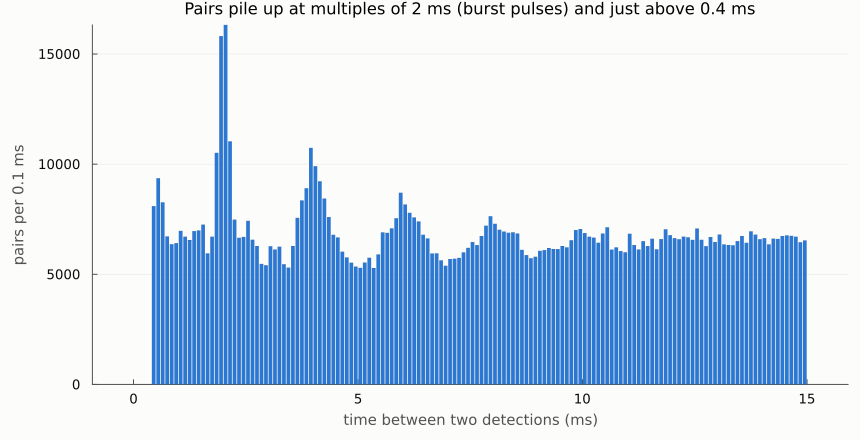
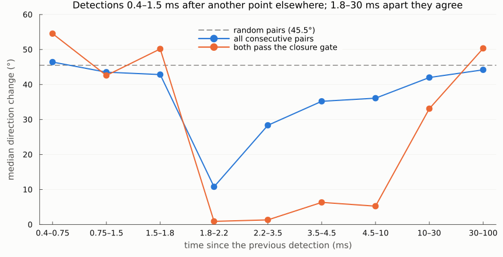
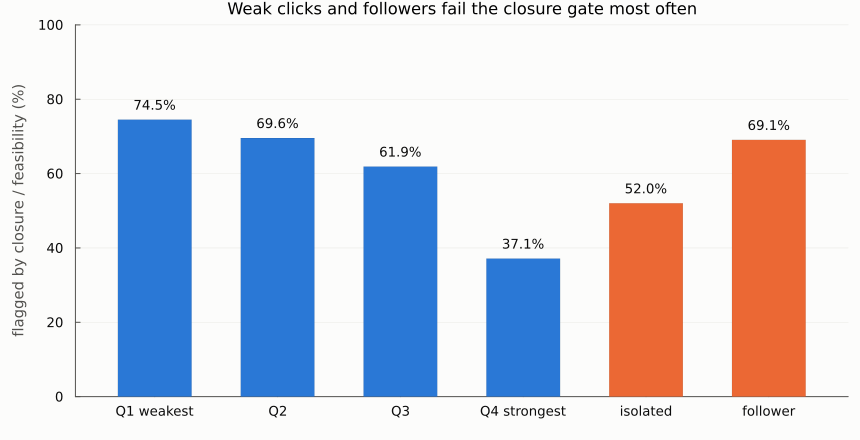
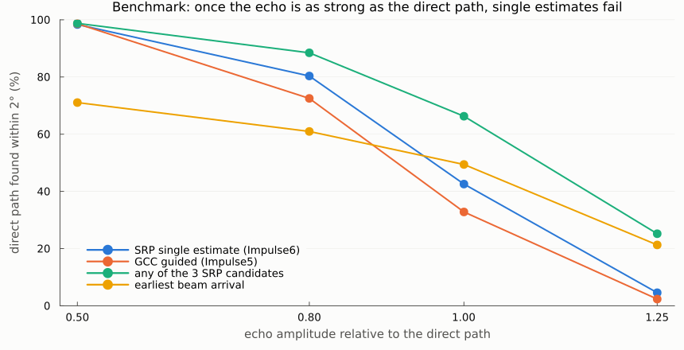

# Round 1 report: multiple arrivals per click — diagnostics, direction candidates, tracking

Date: 2026-10-23 · Device: ophk_acoustic_D3 (Zoom F6, 192 kHz; hydrophones on channels 3–5, a 0.18 m triangle) · Data: `Two-way_2males_06_10_2025/New_device` (3 WAVs, 135,200 in-train clicks)
Plan: `reviews/plans/multiarrival-candidates-tracking_2026-10-22.md` · Commits: `4549348`, `0767d48`, `ceb3aea` (branch `dev2`)

## In one paragraph
The video overlay gets one direction per click. That direction is unreliable because most clicks reach the array by more than one path. Half of all detections are later arrivals (echoes or the other animal) 0.4–1.6 ms after another detection. 93% of analysis windows contain overlapping arrivals, and that overlap is what makes 60% of clicks fail the closure gate. Keeping the top 3 SRP direction candidates per click recovers the direct path much more often than a single estimate (69% vs 56% in a semi-synthetic benchmark; 66% vs 43% when the echo is as strong as the direct path). But SRP sidelobes also produce candidates, so the candidate lists and the tracks built from them are noisy. **Next: suppress sidelobes, then select one candidate per click.**

## What was built
| piece | where | what it does |
|---|---|---|
| diagnostics | `scripts/diag_detection_timing.jl`, `diag_train_clusters.jl`, `diag_window_arrivals.jl` (shared loader `common.jl`) | analysis of the existing multitdoa run: timing, direction agreement, clusters per train, arrivals inside the window. Reports in `results/*.md` |
| direction candidates | `src/multiarrival.jl` `get_srp_candidates` | top-K local maxima of the SRP-PHAT map, at least 8° apart and scoring ≥ 0.5 × the best. Candidate 1 is exactly `get_tdoa_srp` (Impulse6). Also returns the beam arrival time per candidate and, per click, the closure, `ncc_min`, GCC peak height and GCC peak count |
| helpers | same file | `envelope_arrivals` (peak count per channel), `follower_flags` (gap to the previous detection < 1.6 ms) |
| tracker | `track_candidates`, `track_colours` | Kalman random walk in direction cosines (u, v); gated greedy assignment; birth / confirm (3 hits in 50 ms) / delete (0.25 s); merging of converged tracks. Concurrent tracks never share a colour |
| driver | `run_multiarrival`, `scripts/run_multiarrival_newdevice.jl` | post-processes a multitdoa result folder: reads padded audio blocks per train, filters them like the pipeline, writes the feature table, tracks, summary and 2 viewer CSVs |
| benchmark | `scripts/bench_multipath.jl` | real clean clicks plus 1–2 synthetic echoes inside the window, plus real noise at 19 dB SNR |
| tests | `test/test_multiarrival.jl` | 219 synthetic tests (all pass; `test_tdoa.jl` 24 and `test_multitdoa.jl` 38 still pass) |

## Findings on the real recording
**1. Half the detections are later arrivals.** 51.4% of detections come 0.4–1.6 ms after the previous one ("followers"). The all-pair lag histogram has peaks at 2, 4, 6, 8 ms (burst pulses of about 500 clicks/s with equal amplitudes; median amplitude ratio 1.00) and an excess just above the detector's 0.4 ms minimum spacing.



**2. A follower points somewhere unrelated to the detection before it.** The direction change between a follower and its predecessor (median 43–55°) equals that of random pairs (45.5°), even when both pass the closure gate. Clicks 1.8–2.2 ms apart (the burst-pulse interval) agree within a median 0.9° when both pass the gate.



- 30% of followers keep the predecessor's bearing (|Δaz| < 3°; random pairs: 7%) and change elevation (Δel p25 −35°, p75 +41°). This is the pattern of surface/bottom reflections.
- Consecutive detections 10–30 ms apart with nothing in between disagree (33°), probably the two animals alternating. Consecutive *clean* clicks (isolated and passing the gate, skipping anything in between) agree within 0.9–2.7° up to 30 ms apart. The clean subset is 23.3% of all clicks.

**3. Overlap inside the ±50-sample window causes most closure failures.**
- 92.9% of windows have ≥ 2 envelope peaks on some channel (sample of 3,764 clicks).
- Single-arrival windows are flagged 20.9% of the time; multi-arrival windows 61.0%.
- Weak clicks and followers fail most often.



**4. Taking the earliest arrival is not the fix.** 84% of detections have a weaker envelope peak 0.4–0.7 ms earlier. But a window placed on that earliest peak is worse than the current window:
- closure pass 22% vs 32%;
- direction change between consecutive isolated clicks: median 37.5° vs 14.9°.

So the earlier peaks are reverberation, not the direct path.

**5. Two directions per train.** 159 of 215 trains (those with ≥ 20 clean clicks) hold ≥ 2 direction clusters of ≥ 10% each.
- The second cluster is mostly not time-locked to the first: 54% of its clicks come > 30 ms after the last cluster-1 click, against 50% for random times. That points to the other male or to movement.
- A small echo-locked share appears at 1.6–2.5 ms (8.0% vs 3.8%).
- ICI medians: 5.9 ms for cluster 1, 13.1 ms for cluster 2.

## Benchmark: can candidates recover the direct path?
3,000 trials. Each uses a real clean click (one of 300 templates) from a random direction inside the field of view, plus 1–2 echoes delayed 52–302 µs: gain 0.5–1.25, polarity ±, from a vertical image or a random azimuth. Real noise is added at 19 dB SNR, and the detection sits on the strongest arrival, as in the pipeline.



| share with the direct path within 2° | SRP single (Impulse6) | GCC guided (Impulse5) | any of 3 candidates | earliest beam |
|---|---|---|---|---|
| all trials | 55.8% | 50.8% | **69.2%** | 50.3% |
| echo gain 0.5 | 98.3% | 98.6% | 98.8% | 71.1% |
| echo gain 0.8 | 80.3% | 72.5% | 88.4% | 61.0% |
| echo gain 1.0 | 42.6% | 32.8% | **66.3%** | 49.4% |
| echo gain 1.25 | 4.6% | 2.3% | **25.2%** | 21.3% |

- A single estimate locks onto whichever arrival is strongest. Guided GCC (Impulse5) is a little worse than SRP (Impulse6) under multipath.
- Candidates carry the direct path much more often, but **nothing selects it yet**. The earliest beam arrival is not a usable selector: a beam aimed at a sidelobe still peaks at the time of the strongest arrival.
- **Sidelobes:** ≥ 2 candidates are found in 98% of trials. For this array, SRP-PHAT sidelobes of a single broadband click reach 0.4–0.6 × the peak, above the 0.5 threshold.

## Results on the real recording (`results/multiarrival_summary_New_device.md`)
| quantity | value |
|---|---|
| candidate 1 equal to Impulse6 (within 0.5°) | 100% of 135,200: the block-wise reading/filtering reproduces the pipeline |
| clicks with ≥ 2 / ≥ 3 candidates | 98.2% / 96.8% |
| median score of candidate 2 / candidate 1 | 0.89 |
| tracks: all / confirmed | 107,098 / 11,443 |
| confirmed tracks: median duration, hits, jitter | 0.19 s, 8 hits, 3.1° |
| clicks on a confirmed track | 83.5% (isolated 85.4%, followers 81.7%) |
| points inside the video frame | Impulse6 57.4%, gated Impulse6 53.2%, Impulse7 63.8% |
| run time | about 14 min, 12 threads |

Viewer files, next to the combined video in `/media/spin/anas2/data/calf/upload/results/tmp_20261007/Two-way_2males_06_10_2025_multitdoa/New_device/`:
- `detection_pixels__color255_webui__Impulse7_srpTracks.csv`: 241,688 rows, one per (click, confirmed track), at the track-filtered direction, coloured by track.
- `..._Impulse8_srpCandidates.csv`: 398,859 rows. Rank 1 is a circle, ranks 2–3 are triangles, and alpha is scaled by the score relative to rank 1.

## Observations and limits
- Tracks are short and many because sidelobe candidates feed the tracker too; colours in Impulse7 change often. Most triangles in Impulse8 are sidelobes.
- The benchmark only places echoes inside the window, gives every hydrophone the same click waveform, and has no echo detections that are separate clicks.
- No ground truth on this recording. The array is portable and each calibration set comes from a different place; more calibration sets will come.
- Run time: the parallel loop runs per block (one train, ≤ 10 s), so with many short trains the threads are underused (about 340% CPU).

## How to reproduce
Prerequisites:
- Julia 1.12 with the project environment (`julia --project=.` from the repository root).
- The data drive `/media/spin/anas2`.
- The multitdoa result folder, which the 2026-10-21 round produced with `src/run_syncVid.jl`.

```bash
# 0. (only if the multitdoa result folder is missing) pipeline run with one webui CSV per TDOA method, about 6 min,
#    up to 30 GB RAM; set res_dir in the script to a new folder
julia --project=. -t 12 src/run_syncVid.jl
R=/media/spin/anas2/data/calf/upload/results/tmp_20261007/Two-way_2males_06_10_2025_multitdoa/New_device
D=improvements/tdoa_localization_2026-10-22

# 1. unit tests (seconds)
julia --project=. -t auto test/test_multiarrival.jl
julia --project=. -t auto test/test_tdoa.jl && julia --project=. -t auto test/test_multitdoa.jl

# 2. diagnostics (about 1-3 min each) -> $D/results/diag_*.md, lag_histogram.csv
julia --project=. $D/scripts/diag_detection_timing.jl $R
julia --project=. $D/scripts/diag_train_clusters.jl $R
julia --project=. -t 12 $D/scripts/diag_window_arrivals.jl $R      # reads WAV snippets of file 0001

# 3. candidates + tracks (about 14 min) -> $D/results/multiarrival_summary_New_device.md/.csv,
#    $D/results/data/click_features_New_device.csv, tracks_New_device.csv, and Impulse7/8 CSVs in $R
julia --project=. -t 12 $D/scripts/run_multiarrival_newdevice.jl $R

# 4. benchmark (about 2 min; needs step 3's feature table) -> $D/results/bench_multipath.csv/.md/.png
julia --project=. -t 12 $D/scripts/bench_multipath.jl 3000

# 5. this report's figures -> $D/reports/figures/*.png
julia --project=. $D/scripts/report_figures.jl
```
From the REPL: `include("src/run_example.jl"); set_device__ophk_acoustic_D3(); include("src/multiarrival.jl"); run_multiarrival(R; out_dir="...")`.
Keyword arguments: `K`, `echo_window_ms`, `candidate_kwargs=(; min_rel, min_sep_deg, grid_deg)`, `tracker_kwargs=(; gate_deg, sigma_meas_deg, sigma_q_deg, n_confirm, t_confirm, t_delete, birth_min_score, merge_deg)`.

## Run on a real recording
Round 1 is the first step of `scripts/run_on_recording.sh` (writes `Impulse7_srpTracks` and `Impulse8_srpCandidates`); the runbook with all steps, outputs and Audacity labels is [how_to_run_on_recordings.md](how_to_run_on_recordings.md).

## Next (round 2)
1. **Sidelobe suppression:** CLEAN the GCC curves. With PHAT, a single arrival's GCC is the band-mask kernel shifted to its lag, so the kernel of each accepted candidate can be subtracted before searching for the next. Measure false candidates on echo-free synthetic clicks.
2. **Selection:** one direction per click, using track continuity and (on cleaned candidates) the beam arrival order. Re-benchmark.
3. **Faster driver:** parallel over blocks.
4. Then: direct vs. image tracks, tracks → the two males, and the false-detection score.
