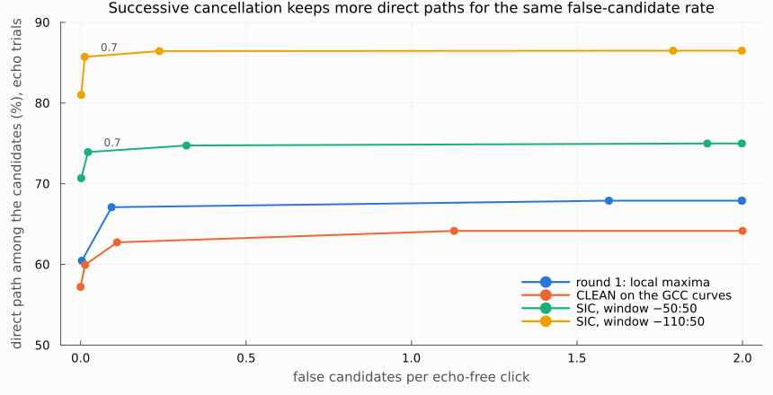
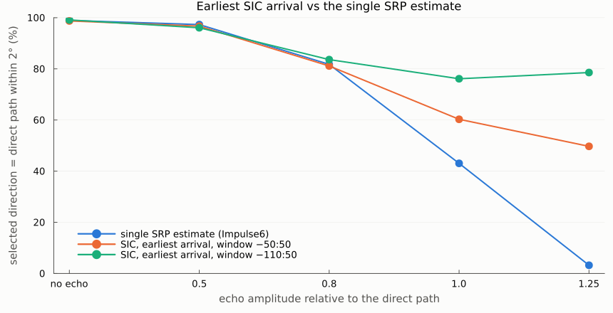
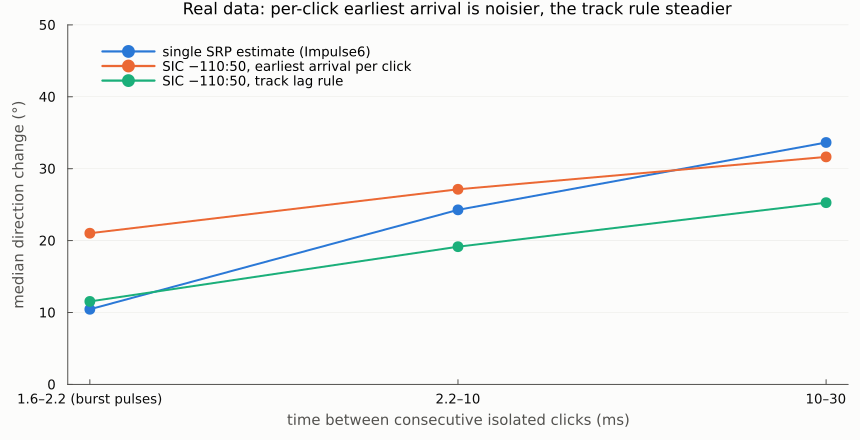
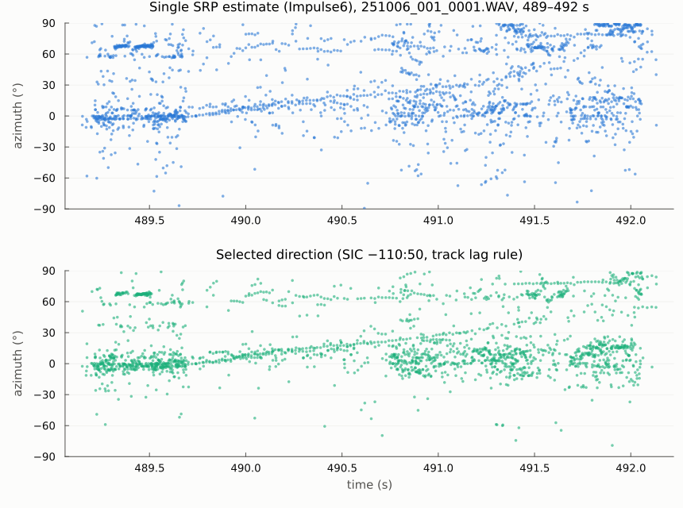

# Round 2 report: removing sidelobe candidates and selecting one direction per click

Date: 2026-10-23 · Device: ophk_acoustic_D3 · Data: `Two-way_2males_06_10_2025/New_device` (135,200 in-train clicks)
Plan: `reviews/plans/multiarrival-round2-clean-selection_2026-10-23.md` · Previous: `round1_candidates_tracking.md`

## In one paragraph
Successive interference cancellation (SIC) is now the candidate generator: it subtracts each accepted arrival from the signals before searching for the next. In the benchmark it removes the sidelobe candidates (0.01–0.02 false candidates per echo-free click, against 1.6–2.0 in round 1) and finds real second arrivals more often (32% vs 18%). The earliest SIC arrival then selects the direct path in 72% of echo trials with the pipeline window and 83% with a window reaching further back (−110:50), against 56% for the single SRP estimate.

**On the real recording that per-click rule does not hold.** 78–79% of clicks still carry an accepted second arrival, because real windows contain reverberation of earlier clicks and the other animal. Taking the earliest one makes consecutive burst-pulse clicks less consistent: a median change of 21° vs 10°.

**Averaging the arrival order over tracks (the track lag rule) is the best real-data selector.** With the −110:50 window:
- consecutive isolated clicks 2.2–10 ms apart change by a median 19.2° (Impulse6: 24.3°), and 10–30 ms apart by 25.3° (33.6°);
- burst pulses stay as consistent (11.5° vs 10.4°);
- 67.7% of the points fall inside the video frame (Impulse6: 57.4%).

The viewer file to check is `Impulse9sicwt_trackSelected`.

## Why this round
Round 1 kept up to 3 SRP direction candidates per click. In the benchmark the direct path was among them in 69% of trials, against 56% for the single estimate. Two problems remained:
- **Sidelobes.** Sidelobes of the main peak produced a second candidate for 98% of clicks, so the tracks were short and fragmented.
- **No selector.** Nothing chose the direct path. The earliest beam arrival scored only 50%, because a beam aimed at a sidelobe still peaks at the strong arrival's time.

## What was built (all in `src/multiarrival.jl`; round-1 functions unchanged)
| function | idea |
|---|---|
| `get_srp_candidates_sic` | **successive interference cancellation (SIC)**. Take the SRP maximum. Beamform the channels towards it and keep only ±10 samples (Hann taper) around the beam's peak: this is that arrival's waveform. Subtract it from each channel at the candidate's TDOAs, with least-squares gains. Recompute GCC-PHAT on what remains, and search again (≥ 8° away). The arrival time of each candidate comes from the residual beam. Candidate 1 equals `get_tdoa_srp` |
| `get_srp_candidates_clean` | CLEAN on the GCC curves: subtract each accepted candidate's PHAT kernel from the pair curves. Kept for comparison: it fails with several arrivals because PHAT is not additive |
| `srp_support` | smallest pair-curve value at a direction. A sidelobe ridge is supported by one pair, a real arrival by all three |
| `track_lags`, `select_candidates` | a track-level selector: each confirmed track's median arrival delay relative to the earliest co-occurring track |
| `run_multiarrival2` | the round-1 driver, now parallel over audio blocks, with a choice of candidate function, window and selection rule |
| `scripts/bench_common.jl`, `bench_multipath2.jl` | benchmark v2: the same generator as round 1 plus echo-free trials; per-candidate rows; a threshold sweep |
| `scripts/run_multiarrival2_newdevice.jl` | runs `sic` (window −50:50) or `sicw` (−110:50) on New_device |
| `scripts/report_figures_round2.jl` | this report's figures |
| tests | `test/test_multiarrival.jl`: 238 tests (19 new) |

## Benchmark v2 (3,000 trials, a third without echo)
Setup: real clean clicks with 0–2 echoes, delayed 52–302 µs, gain 0.5–1.25, random polarity; real noise at 19 dB SNR; the detection sits on the strongest arrival. A candidate is accepted when its score is at least `rel` × candidate 1's (residual score for CLEAN/SIC).



| generator, threshold | direct path among candidates | echo found | false candidates per click (no echo / echo) | selected = direct (earliest arrival) |
|---|---|---|---|---|
| round 1 local maxima, rel 0.5 | 67.9% | 18.5% | 1.60 / 1.60 | 49.3% |
| round 1 + pair support ≥ 0.5 | 65.7% | 14.3% | 0.08 / 0.62 | 59.0% |
| CLEAN, rel 0.7 | 59.9% | 5.8% | 0.01 / 0.30 | 58.6% |
| **SIC, rel 0.7** | **73.9%** | **32.4%** | **0.02 / 0.40** | **71.6%** |
| **SIC, window −110:50, rel 0.7** | **85.7%** | 33.1% | **0.01 / 0.34** | **83.4%** |
| single SRP estimate (Impulse6) | 55.7% | – | – | 55.7% (rank 1) |



Selected direction within 2° of the direct path, by echo amplitude (rel 0.7, earliest arrival):

| echo gain | single SRP | SIC −50:50 | SIC −110:50 |
|---|---|---|---|
| no echo | 98.9% | 98.7% | 99.1% |
| 0.5 | 97.3% | 96.7% | 96.1% |
| 0.8 | 81.7% | 81.1% | 83.6% |
| 1.0 | 43.1% | 60.3% | 76.1% |
| 1.25 | 3.2% | 49.7% | 78.6% |

By echo delay (SIC, earliest arrival): 10 / 20 / 40 / 58 samples → 67.6 / 80.4 / 85.2 / 55.8% with the window −50:50, and 68.5 / 76.9 / 93.7 / 95.4% with −110:50.
The single-SRP column comes from the `sic` trials; in the wider window the single SRP maximum shifts slightly, so its rank-1 rates differ by up to 8 points (51.1% at gain 1.0).

Findings:
- **PHAT is not additive, so cancellation must happen in the signals, not in the GCC curves.** CLEAN on the curves loses real second arrivals: echo found 5.8% vs 32.4% for SIC. Successive cancellation recomputes PHAT on the residual channels and keeps them.
- **In the benchmark, with real arrivals as candidates, the earliest arrival becomes a good selector.** It was 50% in round 1, when sidelobe candidates dominated. (On real data it is not; see below.) With SIC it costs almost nothing when there is no strong echo (98.7% vs 98.9%), and it gains 17–46 points when the echo is as strong as or stronger than the direct path.
- **The window must reach back.** When the strongest arrival is the echo, the detector centres the window on it. If the echo is more than 50 samples (260 µs) late, the direct path falls outside the ±50 window: at 58 samples SIC −50:50 scores 55.8%, the same as the single estimate. A window of −110:50 covers it (95.4% at 58 samples) and lifts the overall selection rate from 71.6% to 83.4%.
- **Threshold.** 0.7 removes the false candidates (0.01–0.02 per echo-free click) and keeps most echoes. Lower thresholds add false candidates without more recall; 0.9 starts losing real arrivals.
- **Caveat:** the benchmark noise comes from quiet stretches. Real windows also hold reverberation and the other animal's clicks. Round 1 showed that the earlier peaks in real windows are mostly reverberation, which a wider window also sees. The real-data run is the check.

## Real data
Two runs, with the same SIC settings (`min_rel` 0.7, K = 3). The real windows behave differently from the benchmark:

| quantity | round 1 (local maxima) | SIC −50:50 (`sic`) | SIC −110:50 (`sicw`) |
|---|---|---|---|
| candidate 1 equal to Impulse6 (within 0.5°) | 100% | 100% | – (different window) |
| clicks with ≥ 2 / ≥ 3 candidates | 98.2% / 96.8% | 78.0% / 63.0% | 79.0% / 62.7% |
| … followers / isolated with ≥ 2 | – | 81.2% / 74.6% | 82.5% / 75.2% |
| tracks, all / confirmed | 107,098 / 11,443 | 102,271 / 8,722 | 57,141 / 6,998 |
| confirmed: median duration, hits, jitter | 0.19 s, 8, 3.1° | 0.21 s, 8, 3.5° | 0.23 s, 9, 3.4° |
| clicks on a confirmed track | 83.5% | 79.4% | 78.8% |
| track rule: direct / echo only / untracked | – | 52.8 / 26.7 / 20.6% | 50.2 / 28.6 / 21.2% |

- The benchmark found 0.01–0.02 false candidates per echo-free click. Real windows hold an accepted second arrival in about 78% of clicks. These are coherent plane waves, most likely reverberation of earlier clicks (walls), echoes and the other male. The benchmark's quiet-stretch noise contains none of them.
- Tracks are somewhat fewer and longer than in round 1, but still short (median about 0.2 s).

**Selection rules on real data** (`scripts/compare_selection_rules.jl`). There is no ground truth, so the proxies are:
- consecutive *isolated* clicks should keep their direction (median change; smaller is better);
- the share of points inside the video frame.

Window −110:50 (`results/selection_rules_sicw.md`; 23,003 / 16,082 / 4,667 pairs):

| rule | differs from rank 1 | 1.6–2.2 ms (burst pulses) | 2.2–10 ms | 10–30 ms | inside frame |
|---|---|---|---|---|---|
| rank 1 (SRP maximum in this window) | 0% | 11.2° | 23.6° | 31.3° | 61.3% |
| earliest arrival per click | 51.0% | 21.0° | 27.1° | 31.6° | 62.9% |
| earliest, score ≥ 0.95 × best | 19.9% | 12.2° | 23.0° | 30.3° | 62.5% |
| largest energy removed | 33.0% | 15.1° | 26.7° | 34.2° | 57.5% |
| **track lag rule** | 30.4% | 11.5° | **19.2°** | **25.3°** | **67.7%** |
| Impulse6 (pipeline window, for reference) | – | 10.4° | 24.3° | 33.6° | 57.4% |

The pipeline window (`results/selection_rules_sic.md`) gives the same ranking, with the track lag rule at 11.6° / 19.6° / 28.6° and 63.9% inside the frame.





Findings:
- **Per-click earliest arrival is not usable on real data.** It doubles the burst-pulse direction change, from 10° to 21°. The earliest coherent arrival in a real window is often reverberation of a previous click (in burst pulses the previous click is only 2 ms earlier), not this click's direct path.
- **The track lag rule works on real data.** It looks at each track's median arrival delay relative to co-occurring tracks over many clicks, which is robust where single clicks are not. It improves the 2.2–30 ms consistency by 5–8° over Impulse6 and the in-frame share by 6–10 points, without hurting burst pulses.
- In the time series (busiest 3 s of file 0001), the track rule removes much of the scatter between −60° and +60° and keeps the stable tracks near 0° and at 65–80°.
- What "track rule: echo only" (27–29%) means: the click's only confirmed tracks lag others. These are drawn as triangles in the viewer file.

Viewer files, next to the combined video in `/media/spin/anas2/data/calf/upload/results/tmp_20261007/Two-way_2males_06_10_2025_multitdoa/New_device/`. Each `detection_pixels__color255_webui__<name>.csv` holds the impulse rows plus the tonal rows:

| name | content |
|---|---|
| **`Impulse9sicwt_trackSelected`** | **recommended**: one point per click, track-rule selection, window −110:50. Circle = direct; triangle = only lagging tracks or untracked |
| `Impulse9sict_trackSelected` | the same with the pipeline window −50:50 |
| `Impulse9sicw_selected`, `Impulse9sic_selected` | per-click earliest arrival (for comparison; noisier). Triangle = follower |
| `Impulse7sicw_tracks`, `Impulse7sic_tracks` | confirmed tracks, coloured by track |
| `Impulse8sicw_candidates`, `Impulse8sic_candidates` | all accepted SIC candidates. Rank 1 is a circle, others are triangles; alpha is scaled by the residual score |

Feature tables: `results/data/click_features_{sic,sicw}_New_device.csv`, 135,200 rows. They hold the round-1 columns plus, per candidate, `rscore_k`, `pmin_k` and `efrac_k`, and per click `selected`, `selected_earliest`, `selected_track`, `track_status`, `az_sel` and `el_sel`. Tracks: `results/data/tracks_{sic,sicw}_New_device.csv`, now with `lag` and `n_shared`. Summaries: `results/multiarrival_summary_{sic,sicw}_New_device.md`.

## How to reproduce
Prerequisites as in round 1: Julia 1.12, `julia --project=.` from the repository root, the data drive, and the round-1 multitdoa result folder plus the round-1 feature table (`results/data/click_features_New_device.csv`, from `scripts/run_multiarrival_newdevice.jl`), which the benchmark uses to pick its templates.

```bash
D=improvements/tdoa_localization_2026-10-22
julia --project=. -t auto test/test_multiarrival.jl                                  # 238 tests, seconds
julia --project=. -t 12 $D/scripts/bench_multipath2.jl 3000                          # benchmark v2 -> results/bench_multipath2*.{md,csv}
julia --project=. -t 12 $D/scripts/run_multiarrival2_newdevice.jl sic               # real data, window -50:50
julia --project=. -t 12 $D/scripts/run_multiarrival2_newdevice.jl sicw              # real data, window -110:50
julia --project=. $D/scripts/compare_selection_rules.jl sicw                         # selection rules -> results/selection_rules_sicw.{md,csv}
julia --project=. $D/scripts/compare_selection_rules.jl sic
julia --project=. $D/scripts/write_track_selection_overlay.jl sicw                   # viewer CSV Impulse9sicwt_trackSelected (track rule)
julia --project=. $D/scripts/write_track_selection_overlay.jl sic
julia --project=. $D/scripts/report_figures_round2.jl                                # figures -> reports/figures/round2_*.png
```
The two real-data runs can run at the same time (12 threads each). Measured with both runs at the same time: `sicw` about 8 min in total (132 + 117 + 44 s per file), `sic` about 14.5 min (160 + 149 + 55 s per file; the rest is writing the outputs). Round 1, single run: about 14 min.

From the REPL: `include("src/run_example.jl"); set_device__ophk_acoustic_D3(); include("src/multiarrival.jl")`, then `run_multiarrival2(res_folder; out_dir, candidate_func=get_srp_candidates_sic, window=-110:50, min_rel=0.7, select_rule=:earliest, tag="sicw")`.
- The feature table always stores both selections (`selected_earliest`, `selected_track`).
- `select_rule=:track` makes the track rule the one used for `az_sel`/`el_sel` and the `Impulse9<tag>_selected` file. `write_track_selection_overlay.jl` writes the track-rule viewer file from an existing feature table.

## Next
1. **Viewer check:** is `Impulse9sicwt_trackSelected` on the animals more often than Impulse6? Compare with `Impulse7sicw_tracks` to see which tracks the rule keeps.
2. **A benchmark with reverberation.** Take the "noise" from inside click trains (between detections) instead of quiet stretches, or add delayed copies of the previous click, and retune `min_rel` and the selection on it. The current benchmark overstates per-click selection.
3. **Reverberation-aware selection:** reject candidates explained by the previous detections, i.e. directions of earlier tracks at arrival times consistent with their echo lags. Then reassess the earliest-arrival rule.
4. **The tracker on SIC candidates:** tracks are still short (median about 0.2 s). Tune the gate, `birth_min_score` and `merge_deg`; try birth from rank-1 candidates only.
5. Then group tracks into sources (the two males), using ICI and spectra (existing HDBSCAN), and build the false-detection score from the feature table. Validate on the calibration sets when available.
