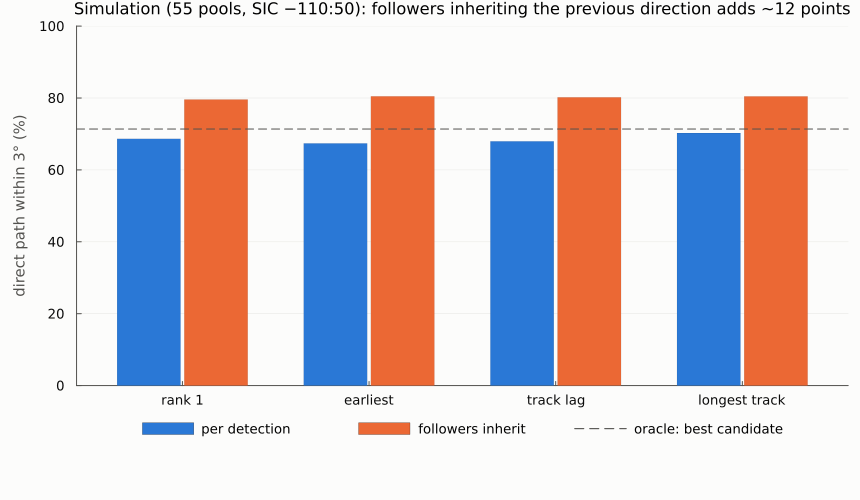
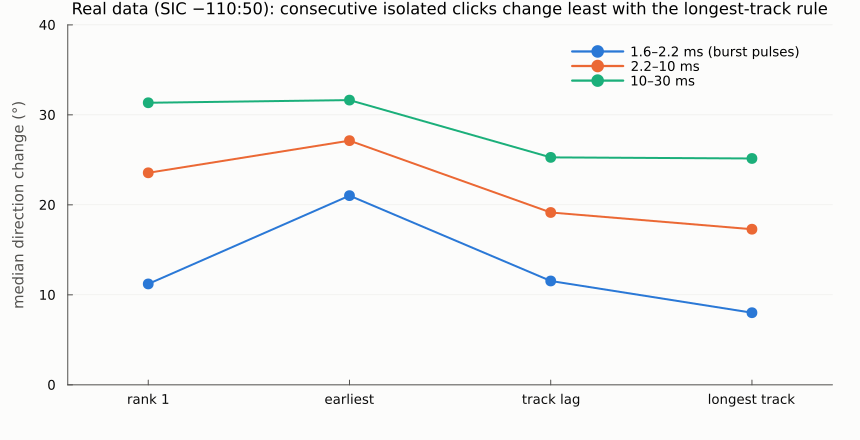

# Round 3 report: reverberant pool simulation and an end-to-end benchmark

Date: 2026-10-24 · Device: ophk_acoustic_D3 · Real data: `Two-way_2males_06_10_2025/New_device` (135,200 in-train clicks)
Plan: `reviews/plans/multiarrival-round3-pool-simulation_2026-10-23.md` · Previous: `round2_sic_selection.md`

## In one paragraph
Round 2's window benchmark had no reverberation, and its per-click conclusion failed on real data. This round builds a pool simulator (image sources, a directional click beam, moving sources, real click templates and noise) and runs the **whole chain** on it, from the pipeline's own detector to SIC candidates, the tracker and the selection rules, scored against ground truth.

**The simulation's clearest result: followers should inherit the previous detection's direction.** 42% of simulated detections are echoes of an earlier click. Mapping them back raises the share of detections drawn at the right place from about 68% to **about 80%** for every rule. The tracker settings barely matter.

**The simulation is still much cleaner than the real recording.** SIC finds a second arrival in 15% of simulated clicks against 78% of real ones, so it cannot validate the real-data proxies.

On real data, the **longest-track rule** gives the most consistent directions:
- burst pulses: median change 8.0°, against 10.4° for Impulse6;
- 2–10 ms apart: 17.3° (24.3°); 10–30 ms apart: 25.2° (33.6°);
- with followers inheriting, 69.3% of the points are inside the frame (57.4%).

**Recommended viewer file:** `Impulse10sicw_default_longesttrack-inherit`.

## What was built
| piece | where | what it does |
|---|---|---|
| pool simulator | `src/pool_sim.jl` | image sources of a rectangular pool up to order 3, with reflection coefficients −0.95 (surface), 0.5–0.8 (bottom and walls, randomized; water–concrete is about 0.7). Click beam: Gaussian main lobe, −3 dB at about 12°, −30 dB floor; images use the mirrored heading. Moving sources with burst-pulse (ICI 1.8–2.5 ms) and echolocation (8–40 ms) trains. Real click templates and real quiet noise (file 0001, 53.5–97.5 s). Output: 5-channel data like the D3 WAVs, plus a truth table per arrival and per click. Random pool and array placement per scenario (the real array is portable) |
| tests | `test/test_pool_sim.jl` | 382 tests: image counts (1 / 7 / 25 for order 0 / 1 / 2), the surface echo's delay, elevation and polarity in closed form, folding at the walls, simulated clicks localizing to their truth within 0.5° |
| end-to-end benchmark | `scripts/bench_sequences.jl` | `calibrate`: source level vs real detection amplitudes. `run`: per scenario, `detect_impulse` (threshold 490.4, file 0001's), `detect_impulsetrain`, SIC candidates (−50:50 and −110:50), 8 tracker settings, 4 rules × (as is / followers inherit), the oracle, truth matching (strongest arrival within ±12 samples), accuracy, echo-label precision/recall, and the real-data proxies computed on the simulation |
| real-data rules | `scripts/apply_rules_real.jl` | reruns the tracker and the rules on the saved real SIC candidates (seconds) and writes the proxies and a viewer CSV |
| figures | `scripts/report_figures_round3.jl` | this report's charts |

## Simulation realism
| quantity | simulation (55 scenarios × 4 s, A0 = 9000) | real New_device |
|---|---|---|
| in-train detections | 22,440 (99.5% matched to an arrival; 61% of them direct-path) | 135,200 |
| detection amplitude / threshold, median | 2.11 (calibration pilot: 1.12 / 1.99 / 6.29 for p10 / p50 / p90) | 1.79 (1.09 / 1.79 / 7.0) |
| followers (0.4–1.6 ms after the previous detection) | 42% (pilot: 52%) | 51% |
| clicks with ≥ 2 SIC candidates (−50:50) | **15%** | **78%** |
| consecutive isolated clicks, median direction change | 0.4–0.5° | 10–34° |

The amplitudes and the follower share are close: the detector sees a similar mix of direct and echo detections. **Inside the analysis windows, the real data is far messier.** The simulation gives every hydrophone the same click waveform; real clicks differ between hydrophones (pair correlation about 0.5, round 2026-10-21). The simulation also stops at third-order specular images, with no scattering, no near-field effects and no off-axis waveform changes. Direct-path detections in the simulation are therefore almost always right (about 99%), and the proxies there are near 0.4°.

## Results on the simulation


Selected direction within 3° of the emitting click's direct path (window −110:50, default tracker):

| rule | all detections | direct-path detections | echo detections |
|---|---|---|---|
| rank 1 (SRP maximum) | 68.6% | 99.6% | 25.7% |
| earliest arrival | 67.4% | 97.8% | 25.2% |
| track lag | 67.9% | 98.0% | 26.3% |
| longest track | 70.3% | 98.5% | 31.0% |
| oracle: best of the 3 candidates | 71.4% | 99.9% | 31.8% |
| **rank 1 + followers inherit** | 79.6% | 91.5% | 63.0% |
| **longest track + followers inherit** | **80.4%** | 91.6% | 65.0% |
| **track lag + followers inherit** | 80.2% | 91.2% | 64.9% |

With the pipeline window (−50:50) the figures are close: 64.4–65.2% per detection and 79.2–80.4% with inheritance.

- **Echo detections are the main loss.** A detection that sits on an echo (42% of detections) usually has no direct path in its window at all; even the best candidate is right only 32% of the time. Inheriting the previous detection's direction recovers 63–65% of them. The cost is followers that are really the other animal's clicks: direct-path accuracy drops from about 98% to about 91%.
- **The tracker settings do not matter here** (gate 4–9°, birth score 0.1–0.3, delete 0.25–0.5 s, process noise 10–40°/√s): all within 0.2 points. Neither does the rule, given inheritance (79.6–80.5%).
- **The track rule's echo label is weak:** precision 44–66%, recall 24–25% against image detections. The follower flag is the better echo indicator.
- **Proxy validation failed.** Across the rules, the rank correlations between accuracy and the proxies range from −0.74 to +0.76, and the proxies barely vary because the simulated windows are clean. The simulation does not say which proxy to trust on real data.

## Results on real data (`results/real_rules_sicw_default_*.md`)


| rule (SIC −110:50, default tracker) | 1.6–2.2 ms (burst pulses) | 2.2–10 ms | 10–30 ms | inside frame | + followers inherit: inside frame |
|---|---|---|---|---|---|
| rank 1 | 11.2° | 23.6° | 31.3° | 61.3% | 63.6% |
| earliest | 21.0° | 27.1° | 31.6° | 62.9% | 65.6% |
| track lag | 11.5° | 19.2° | 25.3° | 67.7% | 69.2% |
| **longest track** | **8.0°** | **17.3°** | **25.2°** | **68.0%** | **69.3%** |
| Impulse6 (pipeline, for reference) | 10.4° | 24.3° | 33.6° | 57.4% | – |

With the pipeline window, longest track gives 7.4° / 17.8° / 28.0° and 65.2% (68.9% with inheritance).

- **Longest track** is the best rule on every real proxy, and also the best per-detection rule in the simulation. It prefers, among the candidates on confirmed tracks, the one on the track with the most hits: the path that persists over a train.
- **The consistency proxies cannot see "followers inherit"**, because they use isolated clicks only. It raises the in-frame share by 1.3–4.6 points. Its support is the simulation and the real follower geometry (round 1: followers are separate arrivals, often vertical images).

Viewer files, next to the combined video in `/media/spin/anas2/data/calf/upload/results/tmp_20261007/Two-way_2males_06_10_2025_multitdoa/New_device/`. Each holds the impulse rows plus the tonal rows; click colours as Impulse6; triangle = follower (for the track-lag file also: not "direct"):

| file `detection_pixels__color255_webui__…csv` | content |
|---|---|
| **`Impulse10sicw_default_longesttrack-inherit`** | **recommended**: longest-track rule, followers inherit, window −110:50 (69.3% inside the frame, 51.4% triangles) |
| `Impulse10sicw_default_tracklag-inherit` | track lag rule + inherit (69.2%; 73.3% triangles) |
| `Impulse10sic_default_tracklag-inherit` | the same with the pipeline window (68.2%) |

## Observations and limits
- The simulation reproduces the detector-level structure (amplitudes, follower share), but not the within-window clutter of the real recording. Every conclusion that depends on within-window structure (per-click selection, proxies) needs real data or a more realistic simulation.
- "Followers inherit" is right when a follower is an echo and wrong when it is the other animal's click. The simulation puts the trade-off at about +12 points overall. Real data may differ, because the two males' clicks interleave more in "Two-way" sessions.
- No ground truth on New_device; the viewer check remains the test.

## How to reproduce
Prerequisites as in rounds 1–2 (Julia 1.12, `julia --project=.` from the repository root, the data drive). Also:
- round 1's feature table `results/data/click_features_New_device.csv`, for the click templates;
- round 2's `results/data/click_features_sic{,w}_New_device.csv`, for the real-data rules.

```bash
D=improvements/tdoa_localization_2026-10-22
julia --project=. -t auto test/test_pool_sim.jl                                     # 382 tests, seconds
julia --project=. -t 12 $D/scripts/bench_sequences.jl calibrate                     # source level vs real amplitudes (~2 min)
julia --project=. -t 24 $D/scripts/bench_sequences.jl run 60 9000                   # 60 scenarios, A0 9000 (~3 min) -> results/bench_sequences*.{md,csv}
julia --project=. $D/scripts/apply_rules_real.jl sicw "default" "longest track + followers inherit"   # proxies + viewer CSV Impulse10...
julia --project=. $D/scripts/apply_rules_real.jl sicw "default" "track lag + followers inherit"
julia --project=. $D/scripts/apply_rules_real.jl sic "default" "track lag + followers inherit"
julia --project=. $D/scripts/report_figures_round3.jl                               # figures -> reports/figures/round3_*.png
```
Per-detection outputs: `results/data/bench_sequences_detections.csv` and `bench_sequences_rules.csv` (167 MB; git-ignored).

## Next
1. **Viewer check** of `Impulse10sicw_default_longesttrack-inherit` against Impulse6.
2. **A more realistic simulation**: hydrophone-specific waveform distortion (e.g. a random short impulse response per hydrophone and arrival), diffuse late reverberation, and off-axis low-pass of the click. Target: about 78% of clicks with a second SIC candidate, as in the real data. Then validate the proxies.
3. **Smarter inheritance:** inherit only when the follower's own candidates include a direction consistent with an image of the leader's direction (same azimuth with a vertical offset, or a track that lags the leader's), so that followers which are the other animal keep their own direction.
4. Then tracks → sources (the two males), and the false-detection score.
