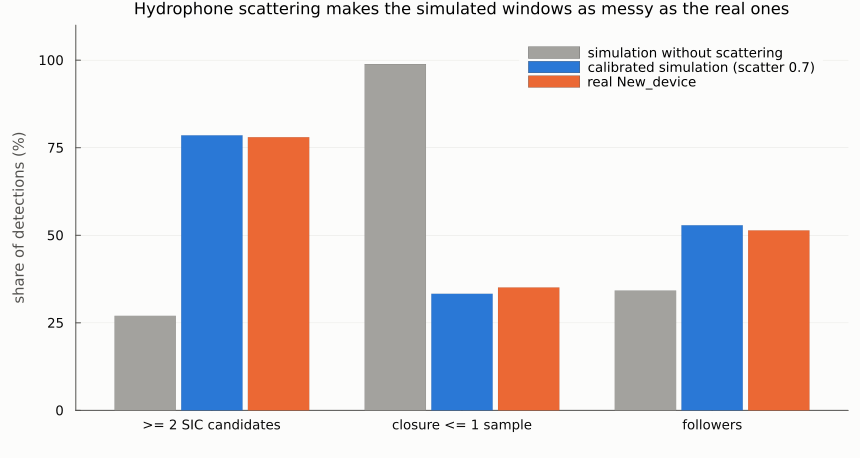
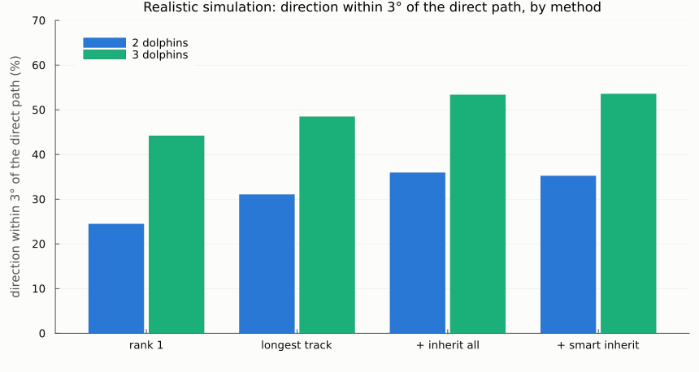
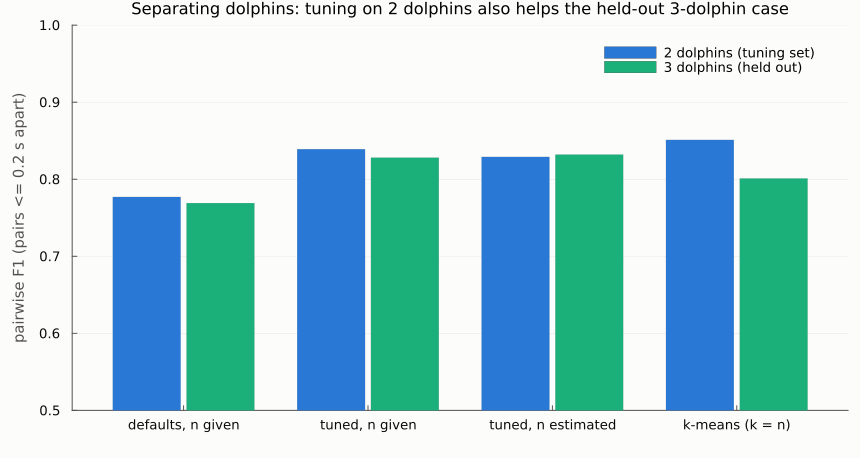
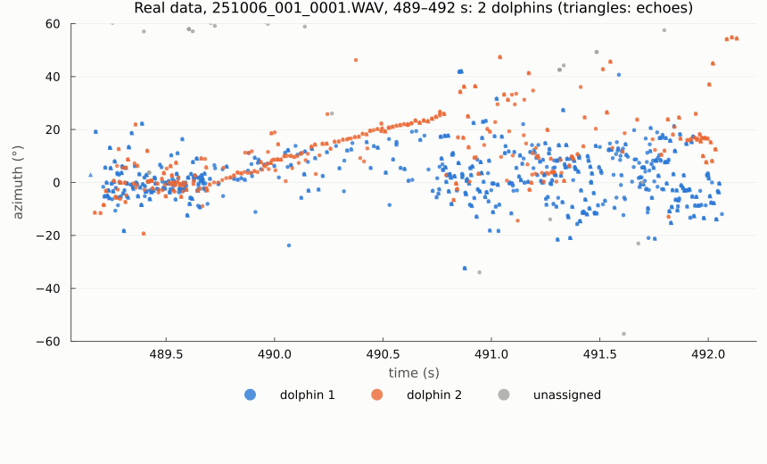

# Round 4 report: a realistic simulation, smarter inheritance, separating n dolphins

Date: 2026-10-24 · Device: ophk_acoustic_D3 · Real data: `Two-way_2males_06_10_2025/New_device` (135,200 in-train clicks, two males)
Plan: `reviews/plans/multiarrival-round4-realism-sources_2026-10-24.md` · Previous: `round3_pool_simulation.md`

## In one paragraph
**The real recording's messy analysis windows come from the hydrophones themselves.** Round 3's simulation was too clean. Adding a fixed, short scattering response per hydrophone (as the mount and housing would cause) reproduces the real within-window statistics almost exactly; diffuse reverberation does not:
- clicks with a second SIC candidate: 78.5% simulated, 78% real;
- closure ≤ 1 sample: 33% vs 35%;
- followers: 53% vs 51%.

**On that realistic simulation, one selected direction per click is right (within 3° of the direct path) for only 35% of detections with 2 dolphins and 54% with 3.** The best method is the longest-track rule plus followers inheriting. A per-click direction is fundamentally noisy at this level of local multipath.

**Separation now works for any number of dolphins**; we tested 2, with 3 as a stress test. After tuning on the simulation (pairwise F1 for detection pairs up to 0.2 s apart):
- 2 dolphins: 0.84 (defaults 0.78);
- 3 dolphins, held out: 0.83, better than k-means (0.80).

**On the real two-male recording, direction-based separation finds coherent moving tracks, but it does not clearly isolate the two males:**
- with `n` = 2, 11.6% of clicks are unassigned;
- click intervals within a "dolphin" are no more regular than in the unseparated stream.

A simple click-rhythm cue did not help (negative result below).

## What was built
| piece | where | what it does |
|---|---|---|
| realism options | `src/pool_sim.jl` | `hyd_scatter`: per hydrophone, a fixed random 3-tap response (4–30 samples, amplitudes N(0, scatter)). `reverb_level`: a diffuse tail per click, i.e. random plane waves with t² density and T60 decay. `offaxis_lowpass`: arrivals low-passed by beam angle. All off by default and drawing no random numbers when off; a fingerprint test shows the defaults reproduce round 3 exactly |
| fix | `src/pool_sim.jl` | the first version of the low-pass option built a list mixing samples and waveforms, so nothing was detected; caught by the calibration, fixed, regression test added |
| tests | `test/test_pool_sim.jl` | 427 tests (21 new): fingerprint, decorrelation by scattering, diffuse arrival timing, low-pass, localization with all options on |
| calibration | `scripts/calibrate_realism.jl` | sweeps scatter × reverb × source level against 7 real statistics, with a distance score |
| dolphin separation | `src/source_separation.jl` | `separate_sources(t, az, el; n=nothing, …)`. Events (non-followers) go to sources by a gated Kalman cost; any number of sources. `n` given: at most n active, labels 1..n reused like track colours, unconfirmed sources replaceable. `n = nothing`: estimated, with converged sources merged. **Smart inheritance:** a follower is an echo of the genuine click (leader, own or repeat) of the last 3 ms with the closest azimuth (it takes that click's direction and dolphin), a repeat of it, or the *other* dolphin's own click (it keeps its own direction). Also `pairwise_scores`, `adjusted_rand` and `kmeans_sources` (baseline), and `SEPARATION_PARAMS_D3` (tuned parameters) |
| tests | `test/test_source_separation.jl` | 32 tests with synthetic streams of 2 and 3 dolphins, n given and estimated, echoes, the other dolphin's clicks within 1.6 ms, clutter, and the k-means baseline |
| benchmark | `scripts/bench_sources.jl` | calibrated simulation: 27 two-dolphin and 14 three-dolphin scenarios of 4 s. Rules × no / all / smart inheritance; separation (n given, estimated, k-means); proxies |
| tuning | `scripts/tune_sources.jl` | 288 parameter sets on the 2-dolphin scenarios, checked on the 3-dolphin ones |
| real data | `scripts/apply_sources_real.jl` | longest-track directions → separation (n = 2 and estimated; tuned or default parameters) → viewer CSVs and plausibility statistics |
| figures | `scripts/report_figures_round4.jl` | this report's charts |

## 1. Realism: what makes the real windows messy


| setting (A0, scatter, reverb; off-axis low-pass on) | ≥ 2 SIC candidates | closure ≤ 1 | ncc_min median | efrac_1 median | followers | amplitude / threshold |
|---|---|---|---|---|---|---|
| 9000, 0, 0 (no scattering) | 27% | 99% | 0.93 | 0.79 | 34% | 2.26 |
| 9000, 0, 0.25 (reverb only) | 26% | 97% | 0.83 | 0.72 | 47% | 2.08 |
| 9000, 0.6, 0.25 | 73% | 50% | 0.30 | 0.38 | 60% | 2.38 |
| 6000, 1.0, 0.1 | 88% | 19% | 0.27 | 0.37 | 57% | 2.10 |
| **6000, 0.7, 0.1 (chosen)** | **78.5%** | **33%** | **0.28** | **0.36** | **53%** | **2.08** |
| real New_device | 78% | 35% | 0.21 | 0.30 | 51% | 1.79 |

All settings: 8 scenarios × 3 s with 2 dolphins. Files: `results/calibrate_realism{,_fine,_target}.md`.

- **Diffuse reverberation barely changes the within-window statistics:** 26–27% of clicks with a second candidate with or without it. It mainly adds follower detections.
- **Per-hydrophone scattering explains the real incoherence.** Waveform similarity between hydrophones drops from 0.93 to 0.28, and the GCC closure fails as often as in the real data. Physically, each hydrophone sees its own short echoes from the mount, housing and cables within about 20–150 µs. Because this part is fixed geometry, it could in principle be calibrated out (see Next).
- The calibrated simulation is still slightly too loud (2.08 vs 1.79) and slightly too coherent (similarity 0.28 vs 0.21).

## 2. Direction per detection on the realistic simulation


Share of detections within 3° of the emitting click's direct path (`results/bench_sources.md`):

| method | 2 dolphins: all | direct-path dets | echo dets | the other dolphin's clicks within 1.6 ms | 3 dolphins: all |
|---|---|---|---|---|---|
| rank 1 (SRP maximum) | 24.5% | 34.5% | 3.3% | 38.1% | 44.2% |
| longest track | 31.1% | 42.8% | 6.4% | 45.4% | 48.5% |
| longest track + inherit all | **36.0%** | 41.7% | 23.9% | 28.4% | 53.4% |
| longest track + smart inherit | 35.2% | 42.0% | 20.9% | 40.2% | **53.6%** |

Median error: 15–19° with 2 dolphins, 1.8–3.6° with 3. Scenario-to-scenario variation is large: the scattering responses are random per scenario.

- **The ceiling is low.** Even direct-path detections are right only about 42% of the time with 2 dolphins: the hydrophone-specific multipath distorts the TDOAs. This is probably the honest scale of the real overlay's per-click error.
- **Inheritance still helps** (+5 points). **Smart inheritance** gives the other dolphin's clicks their own direction (40.2% vs 28.4% right), at a small cost on echoes. Overall it ties with inherit-all.
- Its echo label has precision 72% and recall 35%; it recognises only 10% of the other dolphin's within-1.6-ms clicks as "own" (21% with 3 dolphins). The directions are too noisy for the follower test.
- **The proxies now track the truth better than in round 3.** The rules with the best 2–10 ms and 10–30 ms consistency (longest track and track lag: 1.6° / 3.6°) are also the most accurate; "earliest" has the worst proxies (12–21°) and lower accuracy. The burst-pulse proxy is less reliable (rank 1: 11.9° with 2 dolphins, 1.2° with 3).

## 3. Separating the dolphins


Pairwise scores over detection pairs up to 0.2 s apart (`results/tune_sources.md`; tuned on 2 dolphins, 3 held out):

| method | 2 dolphins: F1 (precision / recall) | 3 dolphins: F1 (precision / recall) | dolphins found (true 1.7 / 2.8) |
|---|---|---|---|
| defaults, n given | 0.777 (0.966 / 0.691) | 0.769 (0.928 / 0.697) | 1.7 / 2.8 |
| defaults, n estimated | 0.787 | 0.797 | 5.2 / 7.8 |
| **tuned, n given** | **0.839** (0.949 / 0.777) | **0.828** (0.913 / 0.778) | 1.8 / 2.8 |
| tuned, n estimated | 0.829 | 0.832 | 4.0 / 4.9 |
| k-means baseline (k = n) | 0.851 | 0.801 | – |

Some scenarios have only one dolphin clicking in their 4 s, hence the 1.7 and 2.8 true counts.

- **The tuned parameters (`SEPARATION_PARAMS_D3`) say the selected directions are noisy:** 8° measurement noise, 25° association gate, 40° forced gate, and a 12° follower gate. They sit at the edge of the grid. Tuning improves F1 by 0.06 on both sets, so it generalises to 3 dolphins.
- **Against the naive baseline,** the tracker beats k-means with 3 dolphins (0.83 vs 0.80) but not with 2 (0.84 vs 0.85). With 2 dolphins far apart, clustering directions is already enough.
- **Estimating n over-counts** (4.0 for 1.7; 4.9 for 2.8): short spurious sources survive confirmation. Give `n` when it is known.
- **A click-rhythm cue did not help (negative result).** I added an inter-click-interval term to the assignment cost, tested it on two dolphins 3–10° apart with different click intervals, and removed it again. F1 stayed at 0.67 (3–6° apart) and 0.85 (10° apart), or dropped slightly. When two dolphins share a direction gate, the first source absorbs both streams and its "rhythm" becomes the mixed interval, so the cue never splits them. Using rhythm needs multi-hypothesis click-train separation (as in PAMGuard's click-train detector), not a cost term.

## 4. The real two-male recording


`results/real_sources_sicw_{tuned,defaults}.md`. Directions: longest-track rule on the round-2 SIC −110:50 candidates.

| | n = 2, defaults | **n = 2, tuned** | n estimated, tuned |
|---|---|---|---|
| unassigned | 48.0% | **11.6%** | 4.5% |
| roles: leader / own / repeat / echo | 26 / 3 / 5 / 18% | 45 / 6 / 6 / 31% | 48 / 16 / 7 / 25% |
| dolphins found | 2 | 2 | 182–582 per file (short-lived) |
| consecutive genuine clicks 2–30 ms apart, within a dolphin: median direction change | 1.6° | 5.5° | 3.8° |
| … unseparated stream | 2.1° | 11.0° | 14.7° |
| ICI change between consecutive intervals, within a dolphin vs unseparated | 6% vs 5% | 20% vs 15% | 20% vs 11% |
| inside the frame | 70.4% | 72.7% | 72.7% |

The unseparated reference changes with the parameters because the set of genuine clicks changes.

- **With the tuned parameters, 88% of clicks get one of the two labels.** Within a label, consecutive clicks change direction by half as much as in the unseparated stream. The busiest 3 s of file 0001 show one label following a coherent track that rises from 0° to 25° in about a second (one animal swimming), while the other stays near 0°.
- **But the labels are not the two males throughout.** Both labels have similar median directions (3.1° / −1.8° and 2.6° / −0.5°), and click intervals within a label are *less* regular than in the unseparated stream (20% vs 15% change). The males are probably often in similar directions, and labels then swap or mix.
- With `n` estimated, the real data yields hundreds of short sources: 2 simultaneously active in 23% of the seconds with clicks, 3 in 18%, 4 in 13%. Direction alone cannot count the animals here.

Viewer files, next to the combined video in `/media/spin/anas2/data/calf/upload/results/tmp_20261007/Two-way_2males_06_10_2025_multitdoa/New_device/`. The direction is the longest-track rule with smart inheritance; dolphin 1 is blue (`#2a78d6`), dolphin 2 orange (`#eb6834`), unassigned grey at half alpha; echoes are triangles at their click's direction:

| file `detection_pixels__color255_webui__…csv` | content |
|---|---|
| **`Impulse11sicw_sources_n2_tuned`** | **recommended to check**: 2 dolphins, tuned parameters |
| `Impulse11sicw_sources_auto_tuned` | n estimated (colours cycle through the track palette) |
| `Impulse11sicw_sources_n2_defaults`, `…_auto_defaults` | the same with the default parameters (48% unassigned) |

## How to reproduce
Prerequisites as in rounds 1–3 (Julia 1.12, `julia --project=.` from the repository root, the data drive). Also:
- round 1's feature table `results/data/click_features_New_device.csv` (click templates);
- round 2's `results/data/click_features_sicw_New_device.csv` (real candidates).

```bash
D=improvements/tdoa_localization_2026-10-22
julia --project=. -t auto test/test_pool_sim.jl                     # 427 tests
julia --project=. -t auto test/test_source_separation.jl            # 32 tests
# realism calibration (8 scenarios x 3 s per setting; 2.5-4 min per sweep on 24 threads)
julia --project=. -t 24 $D/scripts/calibrate_realism.jl 8 9000                                       # -> results/calibrate_realism.md
SCATTERS="0.8,1.0,1.3" REVERBS="0.1,0.25" TAG="_fine" julia --project=. -t 24 $D/scripts/calibrate_realism.jl 8 6000 9000
SCATTERS="0.7" REVERBS="0.1" TAG="_target" julia --project=. -t 24 $D/scripts/calibrate_realism.jl 8 4500 6000
# benchmark on the calibrated simulation (defaults A0 6000, SCATTER 0.7, REVERB 0.1; about 2 min) -> results/bench_sources*.{md,csv}
julia --project=. -t 24 $D/scripts/bench_sources.jl 30 15
julia --project=. -t 24 $D/scripts/tune_sources.jl                  # separation parameters -> results/tune_sources.{md,csv}
# real data: n = 2 with tuned parameters (and the defaults) -> results/real_sources_sicw_*.md, viewer CSVs Impulse11*
julia --project=. $D/scripts/apply_sources_real.jl 2 tuned
julia --project=. $D/scripts/apply_sources_real.jl 2 defaults
julia --project=. $D/scripts/report_figures_round4.jl               # figures -> reports/figures/round4_*.png
```
From the REPL:

```julia
include("src/source_separation.jl")
s = separate_sources(t, az, el; follower=follower, n=2, SEPARATION_PARAMS_D3...)
```
- `s.label` gives 1..2, or 0 for unassigned.
- `s.az` / `s.el` hold the directions after inheritance.
- `s.role` is one of leader / own / repeat / echo / unassigned.
- `n = nothing` estimates the number of dolphins.

## Next
1. **Viewer check** of `Impulse11sicw_sources_n2_tuned`: do the two colours follow the two males, at least while they are apart?
2. **Equalize the hydrophones.** The dominant error source is a fixed per-hydrophone response, so estimate it from many strong clicks and deconvolve before GCC/SRP. In the simulation this can be tested directly, since the true responses are known.
3. **Multi-hypothesis click-train separation** (ICI continuity, as in PAMGuard) for dolphins in similar directions. The cost-term version did not work.
4. **Spectral identity:** the existing HDBSCAN spectra (`src/hdbscan.jl`, `src/cluster_plot.jl`) as a per-click feature in the source assignment.
5. **Video labels** of which male is where, for a real ground truth of the separation; and the calibration sets when available.
