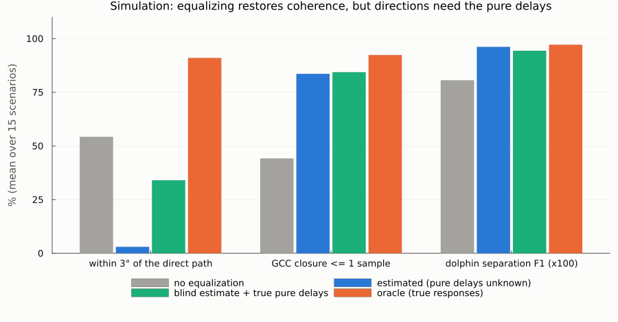
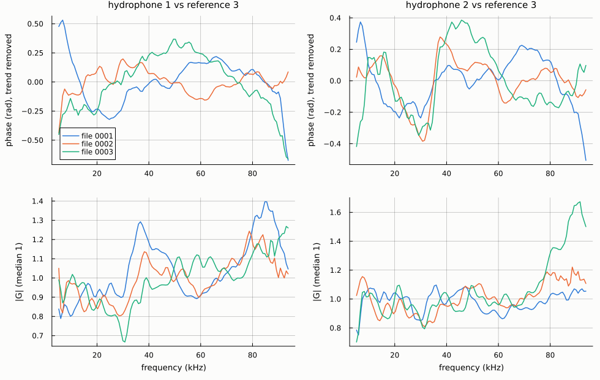
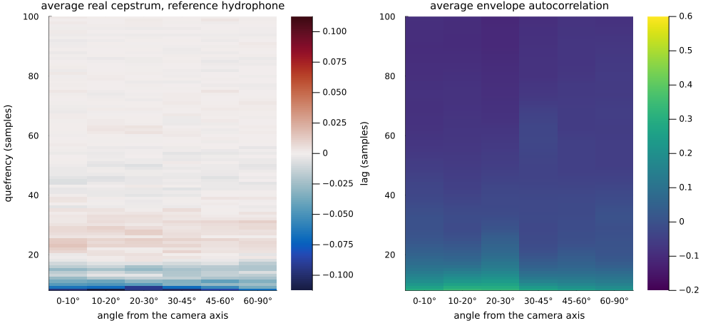

# Round 5 report: hydrophone equalization

Date: 2026-10-24 · Device: ophk_acoustic_D3 · Real data: `Two-way_2males_06_10_2025/New_device`
Plan: `reviews/plans/multiarrival-round5-hydrophone-eq_2026-10-24.md` · Previous: `round4_realism_sources.md`

## In one paragraph
Round 4 explained the real recording's incoherent analysis windows with a fixed scattering response per hydrophone, because such a response reproduced the real window statistics in the simulator. If that were true, equalizing the hydrophones would be a big win: in the simulation an oracle equalizer lifts the share of directions within 3° of the truth from 54% to 91%, and dolphin-separation F1 from 0.81 to 0.97. I built two estimators that work from the data alone: one aligns clicks by their direction, the other is direction-free ("blind"). Both restore coherence in the simulation (closure ≤ 1: 44% → 79–84%). They cannot fix the absolute direction, though, because a pure delay per hydrophone is not identifiable without a calibration recording.

**On the real recording the hypothesis fails:**
- **The real fixed responses are tiny.** Dispersive phase 0.07–0.09 rad and magnitude spread 1.3–1.4×, about 20 times milder than in the calibrated simulation (1.46 rad, 6.7×), and they agree across the three files.
- **Equalizing them changes nothing.** On 4,500 real clicks, closure ≤ 1 goes from 42.8% to 42.9–43.3%, and directions move 0.3–0.5°.
- **No echo tied to the array is present.** The cepstrum and envelope autocorrelation show no in-window echo, fixed or direction-dependent.

**The real incoherence varies from click to click** (overlapping arrivals), so it cannot be removed by any fixed array model. Round 4's calibrated simulation matched the statistics with the wrong mechanism.

## What was built
| piece | where | what it does |
|---|---|---|
| aligned estimator | `src/hydrophone_eq.jl`: `estimate_hydrophone_eq` | self-calibration. Each click's direction comes from SRP on the currently equalized snippet; the channels are aligned by the plane-wave delays, and the relative transfer functions G_m = H_m/H_ref are averaged with their coherence. Iterated; the pure-delay part is removed (reported in `delay_removed`); low-coherence bins are left uncorrected |
| blind estimator | `estimate_hydrophone_eq_blind` | direction-free: \|G_m\| from power-spectrum ratios; dispersive phase from averaged cross-spectrum phase *increments* between adjacent bins (a click's own delay only adds a near-linear term, removed); a constant phase (polarity) by a GCC-peak search |
| apply / delays | `apply_hydrophone_eq`, `hydrophone_eq_firs`, `with_delays` | zero-phase FIR per hydrophone (reference untouched; any number of hydrophones); `with_delays` puts back pure delays from calibration data |
| simulator | `src/pool_sim.jl` | `simulate_scenario` also returns the hydrophone responses (additive; the fingerprint test still holds) |
| tests | `test/test_hydrophone_eq.jl` | 24 tests. Mild responses: the estimate matches an oracle (direction error 0.14° vs 0.12°). Strong responses (a tap of 1.3 and a distorted reference): the blind estimate recovers the dispersive phase, polarity and magnitude, and with the true delays the directions come back under 0.5°. Identity without distortion |
| scripts | `scripts/bench_eq.jl`, `estimate_eq_real.jl`, `eq_effect_real.jl`, `echo_structure_real.jl`, `report_figures_round5.jl` | simulation benchmark; real estimates per file; effect on real clicks; in-window echo structure; this report's chart |

## 1. Simulation: what equalization could do


15 calibrated-realism scenarios × 4 s, 2 dolphins; SIC −110:50, longest track + smart inheritance, separation `n` = 2 (`results/bench_eq.md`):

| version | ≥ 2 SIC candidates | closure ≤ 1 | ncc_min median | within 3°: all / direct-path | median error | separation F1 |
|---|---|---|---|---|---|---|
| no equalization | 71.3% | 44.2% | 0.40 | 54.2% / 58.1% | 1.1° | 0.806 |
| aligned estimate (delays unknown) | 38.5% | 83.6% | 0.61 | 3.0% / 4.1% | 33.8° | **0.961** |
| blind estimate (delays unknown) | 49.3% | 79.4% | 0.65 | 0.4% / 0.7% | 30.0° | 0.916 |
| blind + true pure delays | 30.8% | 84.4% | 0.66 | 34.0% / 39.8% | 6.4° | 0.943 |
| oracle (true responses) | 23.0% | 92.4% | 0.81 | **91.0% / 98.0%** | 0.3° | **0.971** |

- **The potential is large if the distortion is fixed.** Accuracy goes from 54% to 91%, and direct-path detections are almost always right.
- **The estimates restore coherence but shift every direction by a common amount.** A pure delay per hydrophone is unidentifiable from data: it is the same as moving every source by a constant (u, v). Separation still improves (0.92–0.96), because a common shift keeps the relative geometry.
- **With the true pure delays,** the kind of information a calibration recording with known source directions gives, the blind estimate matches the oracle in 6 of 15 scenarios. It fails in the others, where 4 s of data holds too few strong clicks.
- The aligned estimator fails when the raw directions are badly wrong: it aligns clicks by wrong directions (the circularity that motivated the blind estimator).

## 2. Real data: the fixed responses are mild and consistent


From up to 4,000 strongest isolated clicks per file (`results/eq_real_New_device.md`):

| | blind estimate | aligned estimate |
|---|---|---|
| coherence (median, band) | 0.80–0.82 | 0.51–0.74 |
| files agree within (dispersive phase / magnitude) | 0.11–0.20 rad / 6–13% | 0.06–0.12 rad / 6–12% |
| pure delay removed | – | 0.01–0.03 samples |

| fixed relative response | dispersive phase, median \|φ\| | magnitude spread p90/p10 |
|---|---|---|
| real hydrophone 1 / 2 (blind, pooled) | 0.07 / 0.09 rad | 1.4 / 1.3 |
| calibrated simulation (scatter 0.7), 2,000 random draws | 1.46 rad (p10–p90 0.59–2.51) | 6.7 (4.4–9.7) |

**The real hydrophones do have a small fixed response, consistent across files** (e.g. hydrophone 2's phase dip near 30 kHz and rise near 40 kHz), with no pure-delay component relative to the raw directions.

## 3. Real data: equalizing changes nothing
4,500 isolated clicks sampled evenly over New_device, all amplitudes; SIC −50:50 (`results/eq_effect_real.md`):

| version | ≥ 2 SIC candidates | closure ≤ 1 | ncc_min median | SRP score | efrac_1 | direction shift |
|---|---|---|---|---|---|---|
| raw | 74.6% | 42.8% | 0.26 | 0.302 | 0.34 | – |
| blind | 75.0% | 42.9% | 0.26 | 0.303 | 0.34 | 0.48° |
| aligned | 74.6% | 43.3% | 0.26 | 0.303 | 0.34 | 0.28° |

The fixed response is too mild to matter. Because equalization changed nothing on these 4,500 clicks, I did not rerun the full pipeline with it, and there are no new viewer files this round.

## 4. Real data: no in-window echo tied to the array


6,000 strong isolated clicks, binned by the angle from the camera axis and by elevation (`results/echo_structure_real.md`):
- the average real cepstrum and envelope autocorrelation look the same in every bin;
- the only structure is at 3–11 samples, the click's own spectral shape;
- there is no echo whose delay changes with direction, as a reflecting plate or wall behind the array would give (2 d cos θ / c), and no fixed echo.

## Interpretation and consequences
- **The real incoherence is not a property of the array.** About two thirds of a real window's energy does not belong to its strongest arrival (efrac_1 = 0.34). That energy varies from click to click: reverberation of earlier clicks (burst pulses are only 2 ms apart), source-dependent surface/bottom/wall echoes, and the other dolphin. No fixed correction can remove it, so multi-arrival handling (candidates, tracks, inheritance) remains the right approach.
- **Round 4's realism calibration needs revising.** It reproduced the real window statistics with strong fixed hydrophone responses, about 20 times stronger than the real ones. Its absolute conclusions are therefore uncertain: the per-click accuracy ceiling of 35–54%, and the tuned separation parameters, which were tuned on errors that are systematic per scenario rather than random per click. Relative comparisons of methods are probably still informative.
- **The tools remain useful** for other recordings or devices with a stronger fixed response. With a calibration recording, the blind estimate plus `with_delays` fixes both the dispersive response and the per-hydrophone delays, which also correct the absolute direction.

## How to reproduce
Prerequisites as before (Julia 1.12, `julia --project=.`, the data drive), plus:
- round 1's `results/data/click_features_New_device.csv` (templates);
- round 2's `results/data/click_features_sicw_New_device.csv` (real click list).

```bash
D=improvements/tdoa_localization_2026-10-22
julia --project=. -t auto test/test_hydrophone_eq.jl                    # 24 tests (~35 s)
julia --project=. -t 24 $D/scripts/bench_eq.jl 20                       # simulation benchmark (~5 min) -> results/bench_eq.md, bench_eq_scenarios.csv
julia --project=. -t 24 $D/scripts/estimate_eq_real.jl 4000             # real estimates (~5 min) -> results/eq_real_New_device.md, data/hydrophone_eq_New_device.jld2, figure
julia --project=. -t 24 $D/scripts/eq_effect_real.jl 1500               # effect on 4,500 real clicks -> results/eq_effect_real.md
julia --project=. -t 24 $D/scripts/echo_structure_real.jl 6000          # cepstrum / autocorrelation by direction -> results/echo_structure_real.md, figure
julia --project=. $D/scripts/report_figures_round5.jl                   # figure -> reports/figures/round5_eq_sim.png
```
From the REPL:

```julia
include("src/localization.jl"); set_device__ophk_acoustic_D3(); include("src/hydrophone_eq.jl")
eq = estimate_hydrophone_eq_blind(data, peaks; fs=fs, rx_vect=rx, ref=3)
data_eq = apply_hydrophone_eq(data, eq)
```
With calibration delays `d` (samples per hydrophone): `apply_hydrophone_eq(data, with_delays(eq, d))`.

## Next
1. **Re-calibrate the simulator with click-varying clutter** instead of strong fixed responses: denser and stronger diffuse reverberation, random per-arrival scattering, and fixed responses limited to the measured mild level. Match the window statistics and the mild fixed response together, then revisit round 4's absolute numbers and the separation tuning.
2. **Multi-hypothesis click-train separation** (ICI continuity) for dolphins in similar directions.
3. **A calibration recording with this mounting** (known source directions) for the absolute direction and the per-hydrophone delays. Feed `with_delays` with it.
4. **Video labels** of the two males as ground truth for the separation.
